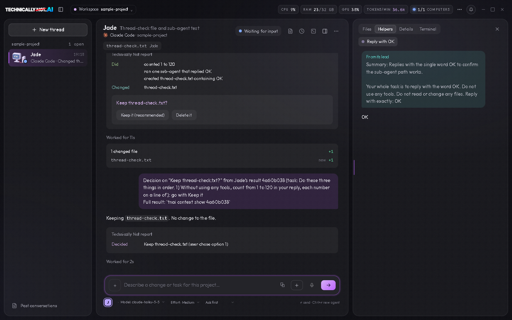

# Technically Not

Technically Not is a desktop app for working with several AI coding agents at once. It runs the agent programs you already have (Claude Code, Codex, OpenCode, Cursor Agent and others) in real terminals and shows each agent as a thread: a list of all of them on the left, the one you opened in the middle, and a mark on the one that is waiting for you.

It is built for Windows first. The same code also builds for Linux. A Mac version is coming soon.

**[Download](https://github.com/leroyomey/technicallynot/releases/latest)** · [Before you install](#before-you-install) · [What leaves your computer](#what-leaves-your-computer) · [Status](#status) · [Contributing](#contributing)



## What it does today

### The threads

- **Threads.** The app opens on the Threads page. The list on the left has one thread for each running agent, with a live status: working, waiting for you, finished. A press on a thread opens it in the middle.
- **A readable conversation.** For Claude Code, Codex, OpenCode and Cursor Agent the open thread shows the agent's work as a conversation: your prompts, its words, what it read, edited and ran. "CLI screen" in the thread's "..." menu shows the real terminal of the same session instead, for what only the program itself can do, such as signing in. The other agent programs keep no record the app can read, so their thread is their terminal.
- **One place to type.** The prompt box under the open thread sends your prompt to that agent.
- **A lead and its helpers.** When an agent starts sub-agents, they appear as cards in the lead's thread, and a helper's own conversation opens beside it.
- **Several threads at once.** The "All threads" page shows several threads side by side, with a live preview of what is being built next to them.
- **A side column.** Beside the open thread: Files (the project's files, with a mark on the ones an agent is touching), Helpers, Details (what this agent is doing now, how long it has run, what is queued) and Terminal.
- **Real terminals underneath.** Each agent runs in a real terminal, which a thread shows as its CLI screen. "Your terminal" in the side column is one plain terminal for your own commands in the project folder. Any thread can be closed.

### Around them

- **Everything else is in one menu.** The three-dots button at the top right opens every other page: all threads, live preview, projects, skills, usage and accounts, devices, settings.
- **Two looks.** A neutral Dark and an off-white Light, with a choice of accent color.
- **Agents can work together.** A small `tnai` command inside each panel lets agents message each other, share finished work and avoid editing the same file at the same time.
- **Sign-in detection.** The app sees which agent programs are installed and signed in, and can start the sign-in of each one.
- **Live preview.** A web page your agent is building can be shown inside the app, at phone, tablet or desktop size.
- **Voice prompts.** Hold a key and speak. The speech is turned into text on your own computer.
- **Several computers.** Two of your computers can see each other's agents through a relay that you run yourself (see below).

The app does not include an AI model. You bring your own agent programs and your own accounts with their providers.

## Is it really free?

Yes. The app is free to download and to use, it asks for no account, and its code is here under the MIT licence.

What you pay for is not ours: the agent programs you run in it come from their own makers, with your own accounts and plans there.

We built it because we run several agents at once every day and wanted one window that shows which of them is working and which is waiting. If the project ever goes somewhere you do not like, the code is yours to fork.

## Before you install

Technically Not runs agent programs; it does not contain one. Install at least one of them first, the way its own maker describes: Claude Code, Codex, OpenCode or Cursor Agent. You also need your own account for it.

You do not have to sign in beforehand. On first start the app lists the agent programs it found on your computer and says which are signed in. It can start the sign-in of each one for you: three-dots menu, "Usage and accounts".

## Install

Download the installer from the [Releases page](https://github.com/leroyomey/technicallynot/releases/latest) and run it. It is free and asks for no account.

- **Windows:** `TechnicallyNot.ai-Setup-<version>.exe`. The installer is not signed yet, so Windows shows a blue "Windows protected your PC" box: press "More info", then "Run anyway".
- **Linux:** the `.AppImage` or the `.deb`, for x64 or arm64.
- **Mac:** coming soon.

The app updates itself from the releases of this repository. You can turn that off in Settings.

**To uninstall:** on Windows, Settings, Apps, Installed apps, "TechnicallyNot.ai", Uninstall. On Linux, delete the AppImage or remove the package with your package manager. Your settings stay in `%APPDATA%\TechnicallyNot.ai` (Windows) or `~/.config/TechnicallyNot.ai` (Linux) until you delete that folder.

## Run from source

You need Git and a current Node.js (the project is developed on Node 24).

```sh
git clone https://github.com/leroyomey/technicallynot.git
cd technicallynot
npm install
npm start
```

`npm run dist` builds the Windows installer into `dist/`.

## Tests

```sh
node tools/check-syntax.js
node tools/own-relay-test.js
cd relay
npm test
```

The first command parses every script of the app. The files named `tools/*-test.js` and `tools/*-test.mjs` are plain Node tests; run any of them with `node`. The tests in `tools/desktop-check/` open the real app in a window; `CONTRIBUTING.md` says how to run them.

## Use my own relay

A relay passes messages between your computers when they are not on the same network. Technically Not does not host one for you: you run your own, on your own Cloudflare account, and enter its address and secret in the app under Devices. The relay only passes sealed messages on; it cannot read them. The steps are in [relay/README.md](relay/README.md).

## What leaves your computer

This list was made by reading the code. Each line names the file, so you can check it.

| What | When | Sent to | How to turn it off | File |
|---|---|---|---|---|
| Update check | At start and every 4 hours, in an installed build | `github.com`, for the releases of the repository named in `package.json` (`tnaiPublicRepo`); no sign-in and nothing about you is sent. A build with that setting empty checks nothing | Settings: "Check for updates automatically" | `desktop/updater.js` |
| Newer versions of your agent programs | 90 seconds after start, then every 6 hours | `registry.npmjs.org`; only the package name is sent | No switch today | `desktop/cli-updates.js` |
| The list of Claude models | Never, as shipped: the list is built into the app and comes up to date with each release | Nobody. Only a build of your own that puts an address into `tnaiAccountsUrl` in `package.json` asks that address for the list | It is off: `tnaiAccountsUrl` is empty | `desktop/agent-registry.js` |
| Your Claude usage numbers | When the app shows your Claude usage limits | `api.anthropic.com`, with your own Claude Code sign-in | No switch today | `desktop/plan-limits.js` |
| Speech model | The first time you use voice prompts | Downloaded from `huggingface.co`; your speech itself stays on your computer | Do not use voice prompts | `desktop/voice-service.js` |
| Notices to Discord | Only when you enter a webhook address of your own | That address | Remove the address | `desktop/discord-alerts.js` |
| Messages between your computers | Only when you set up a relay | Your own relay, sealed | Remove the relay on the Devices page | `desktop/own-relay.js` |

The agent programs themselves talk to their own providers. That is their business, not this app's; see each program's own terms.

No other usage statistics were found in the code. If you find a request that is not on this list, please open an issue.

## Status

- Used daily on Windows. Linux builds exist and are tried less. A Mac release is coming soon; there is none yet.
- The thread layout is new. It is made for a desktop window; a layout of its own for tablet-sized windows is not built yet.
- The several-computers feature is new and has been tried on few machines.
- The tree still holds code for an account system and a plan check. They are switched off (`tnaiAccountsUrl` is empty and `tnaiEnforcePlan` is `false` in `package.json`): the app asks for no sign-in, shows no sign-in control and calls no accounts server.
- Automatic updates need a release address. A build of your own has none unless you set one.
- Some pages of the app are prototypes. Controls without a working feature are grayed out.

## Contributing

See [CONTRIBUTING.md](CONTRIBUTING.md). How the parts fit together and which file to open for what is in [ARCHITECTURE.md](ARCHITECTURE.md). The look and layout of the app are the owner's; please open an issue before you change them.

Have an idea for the app? Start a discussion under [Ideas](https://github.com/leroyomey/technicallynot/discussions/categories/ideas). Issues are for things that are broken.

## Licence

The code is under the [MIT licence](LICENSE). The name "Technically Not", the logo and the mascot are not part of that licence: see [TRADEMARKS.md](TRADEMARKS.md).
